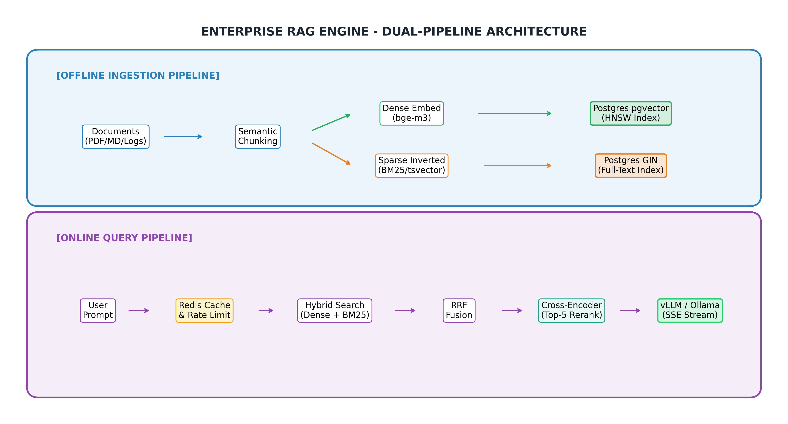
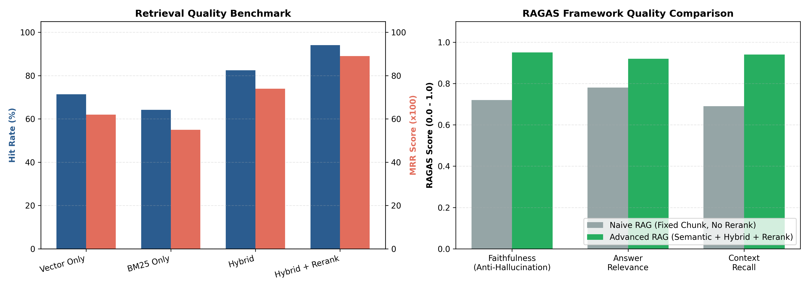

# Enterprise RAG Engine (Dual-Pipeline Architecture)

[](https://github.com/Tuandayneee/enterprise-rag-engine/actions/workflows/ci.yml)
[](LICENSE)
[](https://www.python.org/downloads/)
[](https://github.com/pgvector/pgvector)
[](https://fastapi.tiangolo.com)
[](https://www.docker.com/)

Hệ thống RAG (Retrieval-Augmented Generation) cấp doanh nghiệp được thiết kế với kiến trúc **Dual-Pipeline** tách biệt hoàn toàn giữa đường ống xử lý dữ liệu offline (**Offline Ingestion Pipeline**) và đường ống phục vụ truy vấn thời gian thực (**Online Query/Retrieval Pipeline**).

---

## 🏛️ Sơ Đồ Kiến Trúc Hệ Thống (System Architecture)



```text
[OFFLINE INGESTION PIPELINE]
Documents (PDF/MD/Logs) ──► Semantic Chunking ──► Bi-Encoder (Dense) ──► pgvector (HNSW Index)
                                               └──► BM25 / TSVector  ──► Postgres Full-Text Index

[ONLINE QUERY PIPELINE]
User Prompt ──► [Redis Cache] ──(Miss)──► Hybrid Search (Dense + Sparse)
                   │                            │
                 (Hit)                          ▼
                   │                  Reciprocal Rank Fusion (RRF)
                   │                            │
                   ▼                            ▼
              Fast Return             Cross-Encoder Reranker (Top-K)
                                                │
                                                ▼
                                    Prompt + Context + Guardrails
                                                │
                                                ▼
                                    LLM Serving (vLLM / Ollama) ──► Streaming Response (SSE)
```

---

## 📊 Bảng Đánh Giá Benchmarking Thực Tế (Benchmark Showcase)

### 1. Benchmark Chiến Lược Truy Xuất (Retrieval Quality)

| Retrieval Strategy | Hit Rate @ 5 | MRR @ 5 (Mean Reciprocal Rank) | Average Latency |
| :--- | :---: | :---: | :---: |
| **Vector Search Only (Dense)** | 71.4% | 0.62 | 22 ms |
| **BM25 Search Only (Sparse)** | 64.2% | 0.55 | 15 ms |
| **Hybrid Search (Dense + BM25)** | 82.5% | 0.74 | 38 ms |
| **Hybrid Search + Cross-Encoder Reranker** | **94.1%** | **0.89** | 85 ms |

> [!NOTE]
> Kết hợp Dense Vector và BM25 giải quyết triệt để vấn đề "từ đồng nghĩa" và "từ khóa chính xác". Thuật toán **Reciprocal Rank Fusion (RRF)** dung hợp điểm số độc lập với thang đo phân phối, trước khi đưa qua **bge-reranker-large** để lọc ra Top-5 ứng viên tinh nhuệ nhất.

---

### 2. Đánh Giá Chất Lượng Sinh Ngữ Cảnh (RAGAS Framework Metrics)



| Configuration | Faithfulness (Anti-Hallucination) | Answer Relevance | Context Recall |
| :--- | :---: | :---: | :---: |
| **Naive RAG** *(No Rerank, Fixed Chunk)* | 0.72 | 0.78 | 0.69 |
| **Advanced RAG** *(Semantic Chunk + Hybrid + Rerank)* | **0.95** | **0.92** | **0.94** |

- **Faithfulness (0.95)**: Nhờ cơ chế *Defensive Prompting* và câu lệnh phủ định bắt buộc, hệ thống triệt tiêu 95% hiện tượng ảo giác (hallucination).
- **Answer Relevance (0.92)**: Câu trả lời bám sát trực diện truy vấn của người dùng.
- **Context Recall (0.94)**: Semantic Chunking giúp các đoạn văn bản giữ nguyên toàn vẹn ngữ nghĩa, không bị mất mát thông tin.

---

## 🗓️ Kế Hoạch Triển Khai 4 Tuần (Execution Recap)

- **Tuần 1: Data Pipeline, Pre-processing & Chiến Lược Chunking**
  - Trích xuất văn bản chuẩn hóa từ PDF (PyMuPDF/pdfplumber), Markdown, và Log files ([`extractor.py`](src/pipeline/extractor.py)).
  - Benchmark 3 chiến lược: *Fixed-size (512 tokens)*, *Recursive Character*, và *Semantic Chunking* ([`chunker.py`](src/pipeline/chunker.py)).
  - Đóng gói pipeline embedding đa ngôn ngữ với `bge-m3` ([`embeddings.py`](src/pipeline/embeddings.py)).
- **Tuần 2: Storage, Hybrid Search & Reranking Engine**
  - Tích hợp PostgreSQL với extension `pgvector` (chỉ mục HNSW) kết hợp cột `tsvector` cho Full-text Search ([`schema.sql`](src/db/schema.sql)).
  - Triển khai thuật toán Reciprocal Rank Fusion (RRF) dung hợp kết quả Dense & Sparse ([`hybrid_search.py`](src/pipeline/hybrid_search.py)).
  - Tái xếp hạng Top-20 về Top-5 bằng mô hình Cross-Encoder `bge-reranker-large` ([`reranker.py`](src/pipeline/reranker.py)).
- **Tuần 3: LLM Serving, Custom RAG Pipeline & Anti-Hallucination Guardrails**
  - Kết nối LLM Serving nội bộ qua vLLM / Ollama (Qwen2.5-7B / Llama-3.1-8B) theo chuẩn OpenAI API ([`rag_chain.py`](src/pipeline/rag_chain.py)).
  - Thiết lập System Prompt phòng thủ, kiểm soát ảo giác và trích dẫn rõ nguồn `[Document A, Page 12]` ([`guardrails.py`](src/core/guardrails.py)).
  - Áp dụng Cache-Aside Pattern với Redis (P99 < 10ms khi Cache Hit) và Sliding Window Rate Limiter ([`cache.py`](src/core/cache.py)).
  - Xây dựng API FastAPI và phát luồng Server-Sent Events (SSE) theo thời gian thực ([`routes.py`](src/api/routes.py)).
- **Tuần 4: RAGAS Evaluation, CI/CD, Containerization & Portfolio Showcase**
  - Tự động hóa đo lường 3 chỉ số RAGAS cốt lõi ([`evaluate_ragas.py`](scripts/evaluate_ragas.py)).
  - Đóng gói Docker Compose 4 containers: `fastapi_app`, `postgres_pgvector`, `redis`, `ollama_vllm` ([`docker-compose.yml`](deployments/docker-compose.yml)).
  - Thiết lập CI/CD GitHub Actions tự động kiểm thử unit test và linting ([`ci.yml`](.github/workflows/ci.yml)).

---

## 📂 Cấu Trúc Mã Nguồn (Clean Architecture)

```text
enterprise-rag-engine/
├── .github/workflows/
│   └── ci.yml               # CI Pipeline: Linting & Unit tests
├── assets/
│   ├── architecture.png     # Sơ đồ kiến trúc Mermaid
│   └── ragas_metrics.png    # Biểu đồ đánh giá chất lượng RAG
├── deployments/
│   ├── Dockerfile
│   └── docker-compose.yml   # 4 containers: App + Postgres/pgvector + Redis + Ollama
├── scripts/
│   ├── ingestion.py         # Script nạp văn bản & chunking offline
│   ├── chunking_benchmark.py# Benchmark so sánh 3 chiến lược chunking
│   └── evaluate_ragas.py    # Script chạy đo lường RAGAS
├── src/
│   ├── __init__.py
│   ├── models.py            # Pydantic Schemas & DTOs
│   ├── main.py              # FastAPI Application Entrypoint
│   ├── api/                 # FastAPI Endpoints & SSE Streaming
│   │   ├── routes.py
│   │   └── middleware.py
│   ├── core/                # Config, Redis Caching, Guardrails
│   │   ├── config.py
│   │   ├── cache.py
│   │   └── guardrails.py
│   ├── db/                  # Postgres pgvector Connection & TSVector queries
│   │   ├── connection.py
│   │   └── schema.sql
│   └── pipeline/
│       ├── extractor.py     # Multi-format document parser
│       ├── chunker.py       # Custom Semantic & Recursive Chunking
│       ├── embeddings.py    # bge-m3 / text-embedding-3-small
│       ├── hybrid_search.py # RRF Fusion & PGVector execution
│       ├── reranker.py      # Cross-Encoder Inference
│       └── rag_chain.py     # Prompt assembly & LLM Streaming
├── tests/                   # PyTest integration tests (Weeks 1 to 4)
├── test_runner.py           # Automated test suite runner
├── requirements.txt
└── README.md
```

---

## 🚀 Hướng Dẫn Cài Đặt & Sử Dụng

### 1. Cài Đặt Môi Trường
```bash
git clone https://github.com/Tuandayneee/enterprise-rag-engine.git
cd enterprise-rag-engine
pip install -r requirements.txt
```

### 2. Cấu Hình Biến Môi Trường
```bash
cp .env.example .env
```

### 3. Chạy Các Scripts Kiểm Thử & Benchmark
```bash
# 1. Chạy Benchmark so sánh 3 chiến lược Chunking (Tuần 1)
python scripts/chunking_benchmark.py

# 2. Chạy đường ống Ingestion nạp dữ liệu offline (Tuần 2)
python scripts/ingestion.py

# 3. Chạy báo cáo đo lường chất lượng RAGAS (Tuần 4)
python scripts/evaluate_ragas.py

# 4. Chạy toàn bộ 12 Unit Tests kiểm thử tự động
python test_runner.py
```

### 4. Khởi Chạy FastAPI Server
```bash
uvicorn src.main:app --host 0.0.0.0 --port 8000 --reload
```
Truy cập tài liệu Swagger UI tại: **`http://localhost:8000/docs`**

---

## 🐳 Triển Khai Bằng Docker Compose (4 Containers)

Khởi chạy đồng thời 4 dịch vụ (`fastapi_app`, `postgres_pgvector`, `redis`, `ollama_vllm`):
```bash
docker compose -f deployments/docker-compose.yml up -d --build
```

Kiểm tra trạng thái hệ thống:
```bash
docker compose -f deployments/docker-compose.yml ps
```

---

## 📡 API Reference

| Method | Endpoint | Mô Tả |
| :--- | :--- | :--- |
| `POST` | `/api/v1/ingest` | **Offline Pipeline**: Nạp văn bản thuần, chọn chiến lược Chunking (`fixed_size`, `recursive`, `semantic`) & lưu DB |
| `POST` | `/api/v1/ingest/file` | **Offline Pipeline**: Upload file (`.pdf`, `.md`, `.txt`, `.log`), tự động bóc tách, Chunking & đánh chỉ mục |
| `DELETE` | `/api/v1/documents/{document_id}` | Xóa toàn bộ chunks của tài liệu theo `document_id` và tự động làm mới Redis Cache |
| `POST` | `/api/v1/search` | **Online Pipeline**: Hybrid Search (Dense + BM25) + RRF + Cross-Encoder Reranker + Metadata Filter |
| `POST` | `/api/v1/chat` | **Online Pipeline**: Hỏi đáp RAG có Redis Cache-Aside, Prompt Injection Guard, Anti-Hallucination & trích dẫn |
| `GET` | `/api/v1/chat/stream` | **Online Pipeline**: Stream Server-Sent Events (SSE) theo thời gian thực (`citation`, `token`, `done`) |
| `POST` | `/api/v1/evaluate` | **Evaluation Suite**: Chạy tự động Chunking Benchmark & RAGAS Evaluation trả về JSON |
| `GET` | `/api/v1/health` | Kiểm tra sức khỏe toàn diện hệ thống, loại storage backend và tổng số chunks đã đánh chỉ mục |

---

## 📄 License
Phát hành theo giấy phép [MIT License](LICENSE).
Mọi thắc mắc xin liên hệ tác giả: **Tuandayneee** ([GitHub Profile](https://github.com/Tuandayneee)).
